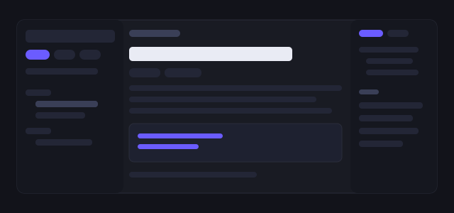

# Knowledge base · Obsidian (@wagq/dsh-obsidian)

Connect a local **Obsidian vault** to [DeepSeek Harness](https://github.com/deepseek-ai/dsh) (DSH): the sidebar gains a three-column knowledge workspace, and the assistant in chat gets a matching `kb_*` tool set. Both sides read and write **the same vault** — a note you edit in the panel is instantly visible to the agent, and a note the agent writes appears in the panel on refresh.

- Sidebar: library / document / outline · related · Q&A, rendered Markdown reading plus in-place editing
- Right-click: new note, new folder, rename, delete (moved to `.trash`, reversible) — type a name, never a path
- Chat: 16 `kb_*` tools for search, read, write, move, delete, mkdir and whole-vault Q&A
- Zero dependencies: plain `node:fs`, no database, no index files, nothing uploaded



## Install

**From NPM (recommended; also listed in the plugin marketplace)**

```bash
dsh plugin --profile web add @wagq/dsh-obsidian
```

**From source**

```bash
dsh plugin --profile web add github:sdmu-gaoqi/dsh-obsidian
```

Refresh the page (or restart DSH) and a **Knowledge base** icon appears in the sidebar.

You can also use the GUI: **Settings → Plugins → Add plugin** and paste `@wagq/dsh-obsidian` or the GitHub address above.

## Quick start

1. **Have a vault** — open any vault in Obsidian. On startup the plugin reads `obsidian.json` and connects to the currently open one.
2. **Open the panel** — click the **Knowledge base** icon in the sidebar.
3. **Check the connection** — the panel header shows the vault name. If it says the vault is not connected, click **Refresh**; if that still fails, set `vaultPath` (an absolute path) in the plugin settings.
4. **Use it** — click a note to read it, switch the toolbar to **Edit** to change it and **Save** to write it back; right-click the tree to manage files.

## Interface

| Area | Content |
| --- | --- |
| **Left · library** | type filter chips (all / notes / PDF / images / other), search box, collapsible folder tree, counts at the bottom |
| **Middle · document** | breadcrumb → title → tags → metadata chips (words / characters / lines / modified / size) → rendered Markdown |
| **Right · sidebar** | `Outline` (jump to a heading) · `Related` (backlinks / outgoing links) · `Ask` (whole-vault Q&A) |

Toolbar: read-only render / preview / edit / save / rename / delete / fullscreen. Leave fullscreen with `Esc` or ⇱.

- The reading view renders headings, paragraphs, lists, quotes, code blocks, tables, `[[wikilinks]]`, inline code and links
- The edit view is a controlled textarea; while dirty, the header shows an unsaved marker and a save button
- Search hits show the matching line number (for example `platform :1`)
- Images use ``, PDFs use `<iframe>`, other files get a download entry

## Right-click menus

Right-click anywhere in the left tree; **you type a name, never a path**:

| Right-click target | Menu items |
| --- | --- |
| folder row | new note · new folder · rename · delete |
| note row | open · rename · delete |
| empty tree space | new note · new folder · new knowledge base project |

- Creating on a folder puts the item inside it; creating in empty space puts it at the vault root
- A new note needs only a name — `.md` is appended automatically and the note opens immediately
- Rename changes the name only; the parent folder stays
- Delete moves the item to `.trash/`, which is reversible; deleting a folder moves its whole subtree

## Whole-vault Q&A

In the **Ask** tab on the right, type a question (`Ctrl+Enter` sends). The plugin

1. tokenizes the query (Chinese and English) and scores the whole vault, taking the top N chunks by heading
2. calls the current default model, answering only from those chunks
3. returns the answer plus a citation list (click one to jump to that note)

If no model is available it falls back to evidence mode: it lists the most relevant chunks instead of inventing an answer. The `kb_ask` tool does the same thing in chat.

## Chat tools

Once installed, the agent in any session can call these tools directly, with no extra authorization step:

| Tool | Purpose |
| --- | --- |
| `kb_status` | connection state, vault path, file counts |
| `kb_list` | list notes, optionally filtered by subdirectory and type |
| `kb_search` | full-text search over titles and bodies, returning matching lines |
| `kb_read` | read one note: body, frontmatter, tags, outline, word count, links |
| `kb_outline` | headings only |
| `kb_write` | create or overwrite |
| `kb_append` | append to the end |
| `kb_move` | move / rename |
| `kb_delete` | move to `.trash/` (reversible) |
| `kb_backlinks` | backlinks |
| `kb_related` | backlinks plus outgoing links |
| `kb_ask` | whole-vault Q&A: retrieval, model answer, citations |
| `kb_tags` | every tag in the vault with usage counts |
| `kb_mkdir` | create a folder |
| `kb_rmdir` | delete a folder (whole subtree to `.trash/`) |
| `kb_create_vault` | create a knowledge base project (vault) and switch to it |

Typical requests, straight in chat:

- “Find every note in this vault that mentions `deploy`, with titles and line numbers” → `kb_search`
- “Read `architecture/gateway.md` and add a `Rate limiting` section” → `kb_read` + `kb_append`
- “Summarize what I did this week from `journal/`” → `kb_list` + `kb_read`
- “Create a knowledge base project named `Reading notes`” → `kb_create_vault`

## Configuration

The plugin settings have one field:

| Field | Meaning |
| --- | --- |
| `vaultPath` | absolute path of the Obsidian vault. When empty, the plugin auto-detects the currently open vault from `%APPDATA%\obsidian\obsidian.json` (`Application Support` on macOS, `.config` on Linux) |

The vault switcher in the panel header moves between registered vaults without touching the config.

## Compatibility

| Item | Requirement |
| --- | --- |
| DSH | `>=0.2.0 <0.3.0` (desktop or web) |
| Node | `>=22.19.0` |
| Platforms | Windows · macOS · Linux (all paths go through `node:path`) |
| Dependencies | none at runtime; `@deepseek-ai/schemastery` is an optional peer shipped with DSH |

## Boundaries

- Only files inside the vault are indexed; escaping paths (`..`, absolute paths, drive letters, UNC) are rejected
- Hidden directories are not indexed: `.obsidian/`, `.trash/`, `.git/`, `.claudian/` and similar
- Delete only moves to `.trash/`; nothing is permanently removed
- A single note is capped at 4 MB; raw file preview is capped at 32 MB
- The local HTTP surface accepts same-origin requests only (`Origin` must match `Host`) and sends `nosniff`
- Nothing is uploaded: all reads and writes happen on the local filesystem; only **Ask** sends retrieved chunks to the current session model

## Development

```bash
git clone https://github.com/sdmu-gaoqi/dsh-obsidian.git
cd dsh-obsidian
dsh plugin --profile web add .
```

`index.js` is the Host face (`export function apply(ctx, config)`, registering `webServer` routes and `tools`); `client.js` is the browser face (`window.__ModuleLoader__.load`, registering the `main` and `sidebar.panellist` slots). A page refresh picks up client changes; Host changes need a DSH restart.

## License

[MIT](LICENSE)

中文：[README.md](README.md)
